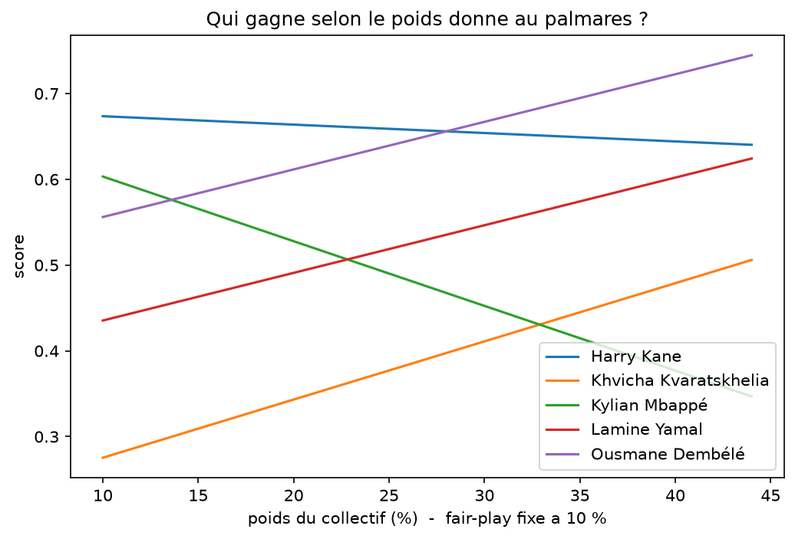
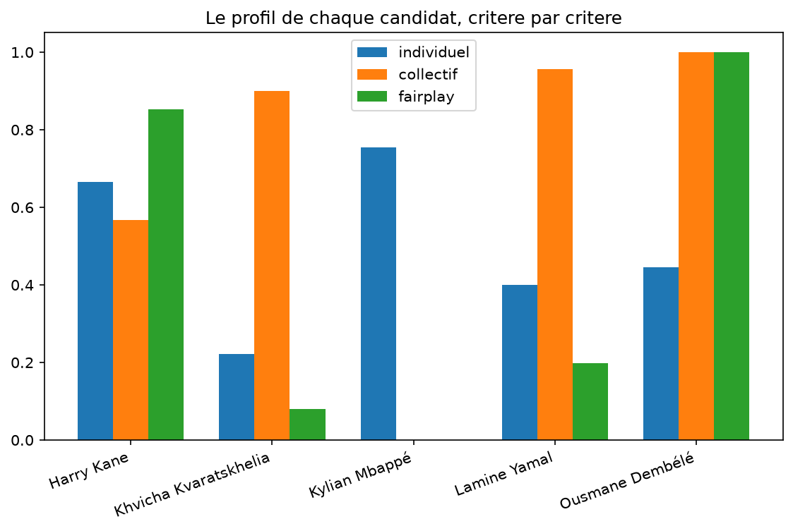

# Qui mérite le Ballon d'Or 2026 ?

Le 26 octobre à Londres, France Football remet le Ballon d'Or 2026. En
attendant, on a pris les cinq attaquants les mieux cotés chez les
bookmakers et les critères officiels du règlement, et on a regardé qui
gagne selon ce qu'on décide de peser.

La réponse courte : Ousmane Dembélé. Il finit premier sous 54 % des
lectures possibles du règlement, contre 40 % pour Harry Kane. Tout se joue
sur le poids qu'on donne au palmarès : en dessous de 28 % environ, Kane
repasse devant. Le marché des paris, lui, classe Dembélé dernier des cinq.

## La méthode en deux minutes

Le règlement officiel (ballondor.com) fixe trois critères par ordre
d'importance, sans pondération chiffrée : 1. performances individuelles et
caractère décisif ; 2. performances collectives et palmarès ; 3. classe et
fair-play. La période d'éligibilité court du 3 août 2025 au 19 juillet
2026, Coupe du monde et CAN incluses (article 3).

Le règlement donne un ordre mais pas de poids. Plutôt que d'en choisir un
à sa place, on calcule le classement sous toutes les pondérations qui
respectent la hiérarchie (individuel > collectif > fair-play, par pas de
5 %), soit 35 lectures possibles. Le scénario central du notebook (60/30/10)
n'est qu'une illustration parmi elles.

Les candidats : les cinq attaquants en tête des cotes bookmakers au
22/09/26 (capture dans `docs/`), à savoir Kane, Yamal, Mbappé,
Kvaratskhelia et Dembélé. On reste entre profils offensifs, parce que nos
indicateurs (buts, création) ne permettent pas de comparer équitablement
un milieu ou un défenseur. Messi, bien coté, est écarté : il joue en MLS,
hors de nos sources de données, et on ne classe pas ce qu'on ne peut pas
mesurer pareil.

Les données viennent de FBref (championnats, Coupe du monde, Ligue des
champions). Le palmarès et les distinctions sont saisis à la main depuis
les palmarès publics.

Ce qu'on mesure, critère par critère :
- *Individuel* : buts hors penalty et passes décisives, en volume et par
  90 minutes, sur la saison complète (championnat + LdC + CDM), plus les
  distinctions individuelles (meilleur joueur de la LdC, soulier d'or...),
  qui traduisent le « caractère décisif et impressionnant » du règlement.
- *Collectif* : les trophées gagnés dans la fenêtre officielle, lecture à
  la lettre de l'article 3. Tout ce qui est gagné entre les deux dates
  compte, supercoupes incluses. Barème choisi : CDM 6, LdC 5, championnat
  3, coupe nationale 1, supercoupe 0.5 (vainqueur = 1, finaliste = 0.5,
  3e de CDM = 0.25, 4e = 0.15).
- *Fair-play* : les cartons par 90 minutes, un rouge pesant trois jaunes.

Chaque indicateur est ensuite ramené entre 0 et 1 sur nos cinq candidats :
le meilleur du groupe vaut 1, le moins bon 0. Un 0 ne veut donc pas dire
« rien », juste dernier du groupe.

## Le profil de chaque candidat

On voit bien trois façons de mériter un Ballon d'Or. Mbappé écrase le
critère individuel mais n'a rien à côté. Dembélé et Kvaratskhelia
s'appuient sur le palmarès parisien, avec la production en plus pour
Dembélé. Kane est le seul à être bon partout, et c'est justement pour ça
qu'il gagne dès que le palmarès pèse peu.

## Le marché avait-il raison ?

Les cotes au 22/09/26 classent : Kane, Yamal, Mbappé, Kvaratskhelia,
Dembélé. Notre score : Dembélé, Kane, Yamal, Mbappé, Kvaratskhelia. Sur
Kane, le marché et le règlement convergent. Sur Dembélé, tout les oppose :
dernier des 5 chez les bookmakers, premier sous une majorité de lectures
du règlement. Réponse le 26 octobre.

## Les limites

- Le fair-play est réduit aux cartons : le règlement parle de « classe »,
  et les données publiques ne permettent pas de la mesurer ;)
- Pas de métriques attendues (xG) dans nos tableaux : on mesure la
  production réelle, comme le jury, qui vote sur ce qui s'est passé.
- La normalisation sur cinq joueurs amplifie les écarts : 0 = dernier des
  cinq, pas nul dans l'absolu.
- Les barèmes du palmarès et des distinctions sont des choix, affichés
  dans le notebook et faits pour être discutés. L'analyse de sensibilité
  montre que la conclusion principale y résiste.

## Reproduire

    python -m venv .venv
    source .venv/bin/activate
    pip install -r requirements.txt
    jupyter lab

Ouvrir `notebooks/01_ballon_dor.ipynb` et tout exécuter. Au premier
lancement, la bibliothèque télécharge les pages via un navigateur piloté
(quelques minutes) ; ensuite tout vient du cache local.

## Sources

Stats : FBref (fbref.com), via la bibliothèque soccerdata. Données mises
en cache localement, non redistribuées dans ce dépôt.
Règlement : ballondor.com, « Tous les critères et le règlement complet du
Ballon d'Or 2026 ».
Cotes : capture datée dans `docs/`.
