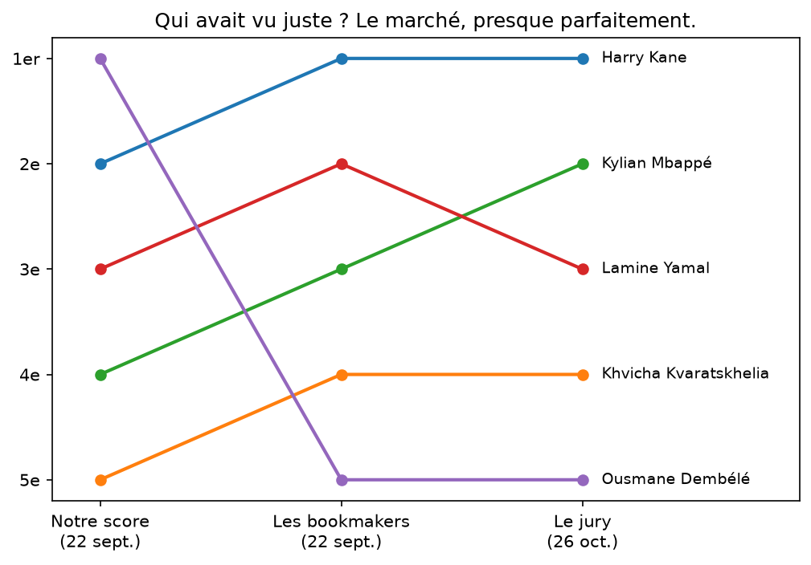
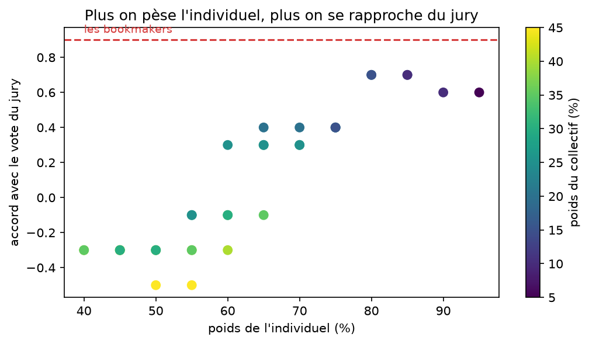

# Qui mérite le Ballon d'Or 2026 ?

> Mise à jour du 26 octobre : Harry Kane a remporté le Ballon d'Or. Notre
> prédiction était Dembélé. Le verdict complet est en bas de page.

Le 26 octobre à Londres, France Football remet le Ballon d'Or 2026. En
attendant, on a pris les cinq attaquants les mieux cotés chez les
bookmakers et les critères officiels du règlement, et on a regardé qui
gagne selon ce qu'on décide de peser.

La réponse courte : Ousmane Dembélé. Il finit premier sous 54 % des
lectures possibles du règlement, contre 40 % pour Harry Kane. Tout se joue
sur le poids qu'on donne au palmarès : en dessous de 28 % environ, Kane
repasse devant. Le marché des paris, lui, classe Dembélé dernier des cinq.

## La méthode en deux minutes

Le règlement officiel (ballondor.com) fixe trois critères par ordre
d'importance, sans pondération chiffrée : 1. performances individuelles et
caractère décisif ; 2. performances collectives et palmarès ; 3. classe et
fair-play. La période d'éligibilité court du 3 août 2025 au 19 juillet
2026, Coupe du monde et CAN incluses (article 3).

Le règlement donne un ordre mais pas de poids. Plutôt que d'en choisir un
à sa place, on calcule le classement sous toutes les pondérations qui
respectent la hiérarchie (individuel > collectif > fair-play, par pas de
5 %), soit 35 lectures possibles. Le scénario central du notebook (60/30/10)
n'est qu'une illustration parmi elles.

Les candidats : les cinq attaquants en tête des cotes bookmakers au
22/09/26 (capture dans `docs/`), à savoir Kane, Yamal, Mbappé,
Kvaratskhelia et Dembélé. On reste entre profils offensifs, parce que nos
indicateurs (buts, création) ne permettent pas de comparer équitablement
un milieu ou un défenseur. Messi, bien coté, est écarté : il joue en MLS,
hors de nos sources de données, et on ne classe pas ce qu'on ne peut pas
mesurer pareil.

Les données viennent de FBref (championnats, Coupe du monde, Ligue des
champions). Le palmarès et les distinctions sont saisis à la main depuis
les palmarès publics.

Ce qu'on mesure, critère par critère :
- *Individuel* : buts hors penalty et passes décisives, en volume et par
  90 minutes, sur la saison complète (championnat + LdC + CDM), plus les
  distinctions individuelles (meilleur joueur de la LdC, soulier d'or...),
  qui traduisent le « caractère décisif et impressionnant » du règlement.
- *Collectif* : les trophées gagnés dans la fenêtre officielle, lecture à
  la lettre de l'article 3. Tout ce qui est gagné entre les deux dates
  compte, supercoupes incluses. Barème choisi : CDM 6, LdC 5, championnat
  3, coupe nationale 1, supercoupe 0.5 (vainqueur = 1, finaliste = 0.5,
  3e de CDM = 0.25, 4e = 0.15).
- *Fair-play* : les cartons par 90 minutes, un rouge pesant trois jaunes.

Chaque indicateur est ensuite ramené entre 0 et 1 sur nos cinq candidats :
le meilleur du groupe vaut 1, le moins bon 0. Un 0 ne veut donc pas dire
« rien », juste dernier du groupe.

## Le profil de chaque candidat

On voit bien trois façons de mériter un Ballon d'Or. Mbappé écrase le
critère individuel mais n'a rien à côté. Dembélé et Kvaratskhelia
s'appuient sur le palmarès parisien, avec la production en plus pour
Dembélé. Kane est le seul à être bon partout, et c'est justement pour ça
qu'il gagne dès que le palmarès pèse peu.

## Le marché avait-il raison ?

Les cotes au 22/09/26 classent : Kane, Yamal, Mbappé, Kvaratskhelia,
Dembélé. Notre score : Dembélé, Kane, Yamal, Mbappé, Kvaratskhelia. Sur
Kane, le marché et le règlement convergent. Sur Dembélé, tout les oppose :
dernier des 5 chez les bookmakers, premier sous une majorité de lectures
du règlement. Réponse le 26 octobre.

## Verdict du 26 octobre

Harry Kane est Ballon d'Or 2026, devant Mbappé et Yamal. Parmi nos cinq
candidats, l'ordre du jury est : Kane, Mbappé, Yamal, Kvaratskhelia,
Dembélé. Notre score central mettait Dembélé en tête : il finit dernier
des cinq.

Les bookmakers, eux, avaient presque tout bon : une seule inversion,
entre Yamal et Mbappé. Accord avec le vote du jury : 0.9 pour le marché,
-0.1 pour notre scénario central. Le marché a gagné, et largement.

Kane gagnait pourtant 40 % de nos lectures du règlement. On a donc
retourné le problème : quelle lecture reproduit le mieux le vrai vote ?

Réponse : un règlement lu avec 80 à 85 % de poids sur l'individuel.
Le jury a voté comme un buteur.

### Le cas Dembélé

Même cette meilleure lecture plafonne à 0.7 d'accord, et la raison tient
en une phrase : dans nos données, Dembélé devance Yamal et Kvaratskhelia
sur les trois critères à la fois. Quand un joueur est devant sur tout,
aucune pondération ne peut le faire passer derrière. Le jury l'a pourtant
classé 7e, derrière les deux. Il a donc jugé quelque chose que nos
indicateurs ne voient pas.

Quelques pistes, qu'on ne peut pas vérifier avec nos données :
- Le barème du palmarès. On compte la LdC et la Ligue 1 de Dembélé
  presque autant que la Coupe du monde de Yamal (9,9 points contre 9,5).
  Le jury semble avoir donné bien plus de poids au titre mondial.
- L'effet deuxième Ballon d'Or. Dembélé était le tenant du titre. Un
  deuxième sacre se mérite peut-être plus nettement que le premier,
  surtout quand l'écart avec les autres n'est pas énorme. Et voir un
  joueur dont personne n'imaginait un premier Ballon d'Or en gagner deux
  de suite, c'est un pas que les votants n'ont pas voulu faire.
- Le partage du mérite parisien. Sept joueurs du PSG finissent dans le
  top 20 du vote. Quand une équipe gagne tout de façon aussi collective,
  les votants répartissent leurs points au lieu de tout donner à une
  seule star : Kvaratskhelia (6e) et Dembélé (7e) se sont sans doute
  pris des voix l'un à l'autre. À l'inverse, Kane et Mbappé sont les
  buteurs de leurs équipes, et les voix convergent vers eux : Olise,
  coéquipier de Kane au Bayern, ne finit que 9e. Nos tableaux jugent
  chaque joueur seul, ils ne voient pas la concurrence entre coéquipiers
  dans l'urne.

Deux de nos exclusions finissent d'ailleurs dans le top 5 : Rodri (4e,
milieu) et Messi (5e, MLS). Notre périmètre « attaquants du top 5
européen » était une vraie limite, et le vote l'a confirmé.

## Les limites

- Le fair-play est réduit aux cartons : le règlement parle de « classe »,
  et les données publiques ne permettent pas de la mesurer ;)
- Pas de métriques attendues (xG) dans nos tableaux : on mesure la
  production réelle, comme le jury, qui vote sur ce qui s'est passé.
- La normalisation sur cinq joueurs amplifie les écarts : 0 = dernier des
  cinq, pas nul dans l'absolu.
- Les barèmes du palmarès et des distinctions sont des choix, affichés
  dans le notebook et faits pour être discutés. L'analyse de sensibilité
  montre que la conclusion principale y résiste.
- Mise à jour du 26/10 : notre volume individuel ne compte que le
  championnat, la LdC et la Coupe du monde. Les coupes nationales
  manquent, et la saison complète de Kane (73 buts toutes compétitions)
  est donc sous-comptée chez nous.
- Comparer des classements de cinq joueurs reste fragile : une seule
  inversion fait passer l'accord de 1 à 0.9. Les écarts entre marché,
  score et jury sont nets ici, mais on ne tirerait pas de loi générale
  d'un seul vote.

## Reproduire

    python -m venv .venv
    source .venv/bin/activate
    pip install -r requirements.txt
    jupyter lab

Ouvrir `notebooks/01_ballon_dor.ipynb` et tout exécuter. Au premier
lancement, la bibliothèque télécharge les pages via un navigateur piloté
(quelques minutes) ; ensuite tout vient du cache local.

## Sources

Stats : FBref (fbref.com), via la bibliothèque soccerdata. Données mises
en cache localement, non redistribuées dans ce dépôt.
Règlement : ballondor.com, « Tous les critères et le règlement complet du
Ballon d'Or 2026 ».
Cotes : capture datée dans `docs/`.
Classement officiel du Ballon d'Or 2026 : presse du 26/10/2026
(France Football).
